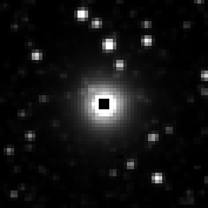
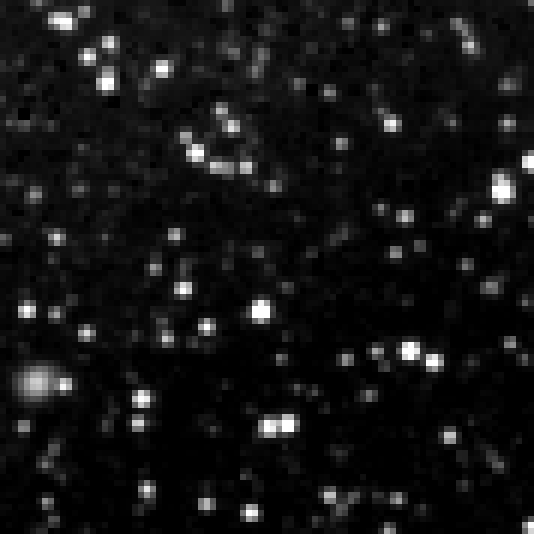
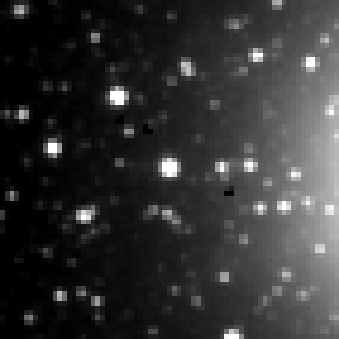
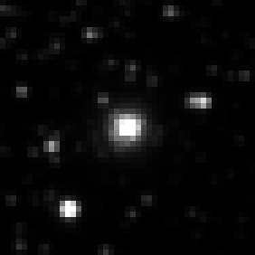
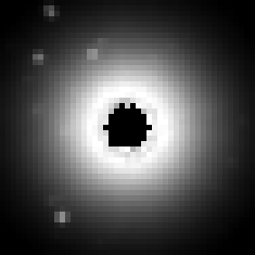

# SPHEREx Blink on real NASA SPHEREx data

Generated automatically by GitHub Actions from live NASA/IPAC IRSA data.

| Target | OK | Exposures | Visits | Frames (date, exp.) | Spectrum pts | λ range (µm) | Time (s) |
|---|---|---|---|---|---|---|---|
| barnards_star | yes | 290 | 6 | 2025-08-25 (100); 2025-09-30 (9); 2026-03-16 (101); 2026-05-04 (7); 2026-08-21 (72); 2026-09-22 (1) | 48 | 3.80–5.00 | 129.9 |
| wise_0855 | yes | 252 | 4 | 2025-05-06 (30); 2025-11-07 (110); 2025-12-12 (17); 2026-05-01 (95) | 252 | 0.74–5.00 | 121.8 |
| eps_indi_b | yes | 337 | 3 | 2025-05-09 (118); 2025-10-11 (146); 2026-04-25 (73) | 337 | 0.75–4.99 | 155.7 |
| rw_aur | yes | 335 | 3 | 2025-09-10 (112); 2026-03-03 (114); 2026-09-11 (109) | 281 | 0.74–5.01 | 141.8 |
| r_dra | yes | 538 | 3 | 2025-06-19 (153); 2025-11-26 (211); 2026-06-07 (174) | 0 | — | 182.4 |

Each animation shows the aligned frames (one per survey visit), north up, east left, target at the centre:

**barnards_star**  

**wise_0855**  

**eps_indi_b**  

**rw_aur**  

**r_dra**  

